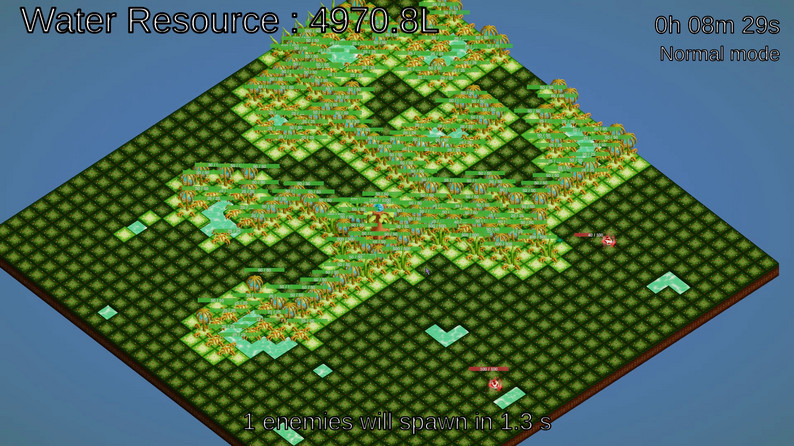
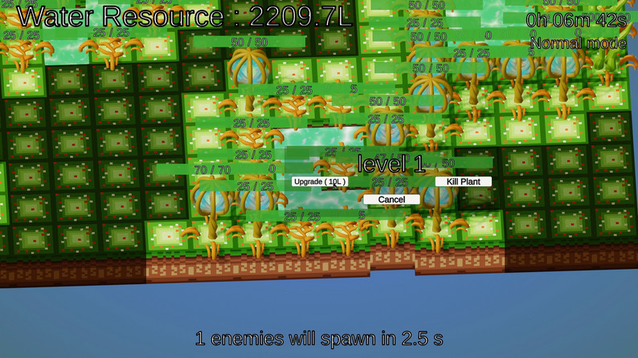
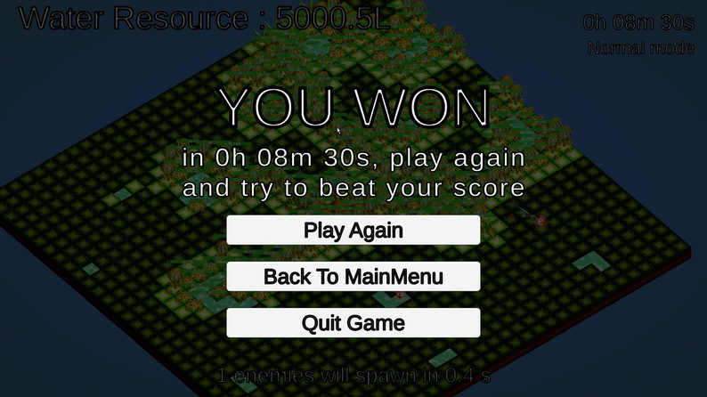

## Rootopia

Rootopia is a tower defense game where you play as a resilient tree fighting to survive against waves of fire enemies.
Grow, adapt, and defend as you spread your roots through the soil in pursuit of one goal: gather 5000 liters of water before you’re burned down.

Originally created for Global Game Jam 2023.
## Download 

https://kakoha.itch.io/rootopia

## Gameplay

In Rootopia, your survival depends on clever placement and resource management.

• Grow your root network to explore the underground and reach water sources.
• Pure roots are the only type that can absorb water.
• Other root types provide defensive and offensive abilities to help you battle incoming fire enemies.
• Plant companions can be grown to support your defense as you expand.
• Manage space, upgrades, and enemy pressure while working toward your water goal.

Every decision matters. Balance growth and defense or you’ll dry up before you hit 5000 liters.

## Features

• Unique root-expansion strategy
• Elemental enemy mechanics
• Defensive plants and specialized root types
• Progressive difficulty
• Run-based gameplay perfect for repeated attempts
• Created in 48 hours for Global Game Jam 2023

## How to Play

Expand your roots strategically.

Use pure roots to gather water.

Build plants and specialized roots to defend against fire enemies.

Survive long enough to reach 5000 liters.

Lose the root system or the main tree and the run ends.

